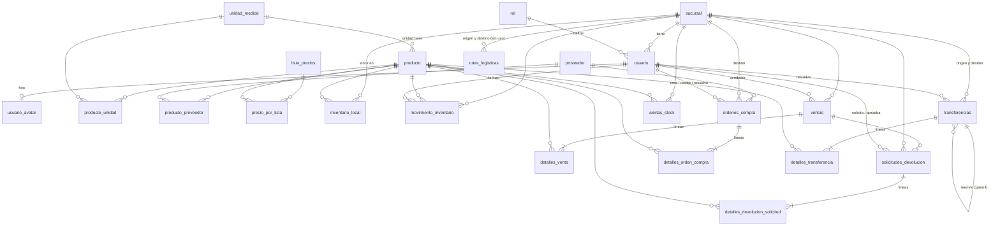

# Arquitectura del backend (guía de estudio)

Este documento explica **cómo está organizado el backend, cómo viaja una petición de principio a fin y cómo se
conectan las tablas**. Cada módulo tiene además su propio `README.md` dentro de su carpeta
(`src/main/java/co/com/zenvory/inventario/<módulo>/README.md`) con el detalle de qué hace cada clase.

Orden recomendado de lectura: este documento → `shared` → `branch` → `auth` → `catalog` → `inventory` → `sale`
→ `purchase` → `transfer` → `alert` → `pricelist` → `analytics`.

---

## 1. Qué es el proyecto

Un sistema de **inventario multisucursal** (Spring Boot 3 + PostgreSQL + Flyway). Una empresa tiene varias
**sucursales**; cada una tiene **stock** de **productos**; se **vende**, se **compra** a proveedores, se **trasladan**
productos entre sucursales y el sistema **avisa** cuando el stock baja del mínimo. El frontend (Angular) consume esta
API REST.

Paquete raíz: `co.com.zenvory.inventario`. Cada subcarpeta es un **módulo de negocio**:

| Módulo | Para qué sirve (una línea) |
|---|---|
| `shared` | Lo común: seguridad (JWT), manejo de errores, usuario actual, datos de la empresa |
| `branch` | Sucursales |
| `auth` | Usuarios, roles, login, perfil y foto |
| `catalog` | Productos, proveedores y unidades de medida |
| `pricelist` | Listas de precios (minorista, mayorista…) |
| `inventory` | Cuánto stock hay de cada producto en cada sucursal + el historial (kardex) |
| `sale` | Ventas y devoluciones |
| `purchase` | Órdenes de compra a proveedores |
| `transfer` | Traslados de mercancía entre sucursales |
| `alert` | Alertas de stock bajo y su resolución |
| `analytics` | Reportes y tableros (solo lee, no guarda nada propio) |

---

## 2. La arquitectura hexagonal, explicada con una analogía

Imagina un **restaurante**:

- **Dominio** = la cocina y sus recetas. Las reglas del negocio ("una venta anulada no se puede devolver").
  No sabe si los pedidos llegan por teléfono o por app, ni si la despensa es una nevera o un almacén.
- **Aplicación** = el jefe de cocina. Recibe un pedido, decide en qué orden se hace, pide ingredientes a otras
  secciones y se asegura de que todo salga o nada salga (transacción).
- **Infraestructura (adaptadores)** = el mesero (HTTP) y el proveedor de ingredientes (base de datos). Traducen
  entre el mundo exterior y la cocina.
- **Puertos** = las "ventanillas" de la cocina. Hay de **entrada** (qué se le puede pedir a la cocina) y de
  **salida** (qué necesita la cocina del exterior). Son **interfaces Java**.

La regla de oro: **las dependencias apuntan hacia adentro**.

```
   HTTP  ──►  Controller  ──►  [puerto IN]  ──►  Service  ──►  [puerto OUT]  ──►  PersistenceAdapter ──► BD
 (afuera)    (adaptador IN)    (interfaz)      (aplicación)      (interfaz)       (adaptador OUT)
                                                    │
                                                    ▼
                                           Dominio (modelo + reglas)
```

`Service` **nunca** importa JPA ni Spring Web; solo conoce interfaces (puertos) y el dominio. Por eso se puede
probar con mocks sin base de datos (los tests del backend corren sin BD).

### Anatomía de un módulo (igual en todos)

```
<módulo>/
├── domain/                          ← EL NEGOCIO (Java puro, sin framework de BD ni web)
│   ├── model/                       ← Clases con datos Y reglas (Sale, Transfer, StockAlert…)
│   ├── exception/                   ← Errores de negocio (SaleNotFoundException, InvalidTransferStateException…)
│   └── event/                       ← Eventos que el módulo anuncia (StockLevelDroppedEvent…) — solo algunos
│
├── application/                     ← LA ORQUESTACIÓN
│   ├── port/in/                     ← "Qué se le puede pedir al módulo": interfaces *UseCase + *Command
│   ├── port/out/                    ← "Qué necesita el módulo del exterior": interfaces *RepositoryPort
│   └── service/                     ← *Service: implementa los UseCase, coordina dominio y puertos, abre la transacción
│
└── infrastructure/adapter/          ← EL MUNDO EXTERIOR
    ├── in/web/                      ← *Controller (endpoints REST) + dto/ (Request/Response = forma del JSON)
    └── out/persistence/             ← *Entity (clase JPA ↔ tabla), Jpa*Repository (Spring Data),
                                       *PersistenceAdapter (implementa el puerto OUT y convierte Entity ↔ dominio)
```

Tabla de "qué es cada tipo de archivo":

| Sufijo | Capa | Qué hace | Ejemplo |
|---|---|---|---|
| `*Controller` | infra / in | Recibe el HTTP, valida permisos, convierte el JSON en un comando y llama al UseCase | `SaleController` |
| `*Request` / `*Response` (dto) | infra / in | Forma exacta del JSON de entrada y de salida | `SaleRequest`, `SaleResponse` |
| `*UseCase` | application / port in | Interfaz: lista de operaciones que el módulo ofrece | `SaleManagementUseCase` |
| `*Command` | application / port in | Objeto con los datos de entrada de una operación (ya sin HTTP) | `CreateSaleCommand` |
| `*Service` | application | Implementa el UseCase. Aquí vive el "paso a paso" del caso de uso | `SaleService` |
| `*RepositoryPort` | application / port out | Interfaz: "guárdame / búscame" sin decir cómo | `SaleRepositoryPort` |
| clases de `domain/model` | domain | Entidades de negocio con sus reglas (calcular totales, cambiar de estado) | `Sale`, `Transfer` |
| `*Entity` | infra / out | Clase JPA mapeada 1 a 1 a una tabla (`@Table(name="ventas")`) | `SaleEntity` |
| `Jpa*Repository` | infra / out | Interfaz Spring Data: genera el SQL por nosotros | `JpaSaleRepository` |
| `*PersistenceAdapter` | infra / out | Implementa el `RepositoryPort` usando el `Jpa*Repository`; traduce Entity ↔ dominio | `SalePersistenceAdapter` |

> **Por qué hay dos clases "Sale" (dominio) y "SaleEntity" (JPA):** el dominio no debe depender de la base de datos.
> El adaptador de persistencia convierte de una a otra (`toDomain` / `toEntity`). Es más código, pero el negocio
> queda aislado.

### Cómo se hablan los módulos entre sí

Un módulo **no toca las tablas de otro**. Si `sale` necesita descontar stock, no escribe en `inventario_local`:
llama a la interfaz `InventoryUseCase` del módulo `inventory`. Eso se ve en los constructores de los `*Service`.

```
sale ──► inventory (descontar / reponer stock)         alert ──► transfer (crear traslado)
sale ──► catalog   (datos del producto)                alert ──► purchase (crear orden de compra)
sale ──► pricelist (precio según lista)                purchase ──► inventory (entrada de mercancía)
sale ──► branch    (nombre de la sucursal)             transfer ──► inventory (reservar / despachar / recibir)
sale ──► auth      (nombre del vendedor)               inventory ──► catalog (producto, unidades, costo promedio)
```

Para cosas que **no deben acoplarse ni bloquearse** se usan **eventos de Spring**:

| Evento | Lo publica | Lo escucha | Efecto |
|---|---|---|---|
| `StockLevelDroppedEvent` | `inventory` (cuando lo disponible queda en/bajo el mínimo) | `alert` | Crea alerta de stock bajo |
| `StockLevelRestoredEvent` | `inventory` (cuando el stock sube sobre el mínimo) | `alert` | Cierra la alerta de stock bajo |
| `TransferPreparedEvent` | `transfer` (cuando el origen autoriza la salida) | `alert` | Cierra las alertas de "solicitud de traslado" |

Los oyentes son `@Async` + `@TransactionalEventListener(AFTER_COMMIT)`: corren **después** de que la transacción
original terminó bien, en otro hilo. Si crear la alerta falla, la venta o el traslado **no se deshacen**.

Además `alert` tiene un **escáner programado** (`@Scheduled`, cada 5 min) que revisa el stock por si algún evento
se perdió.

---

## 3. Recorrido completo de una petición: «registrar una venta»

`POST /api/v1/sales` con el JSON de la venta:

1. **Seguridad (`shared`)** — `JwtAuthenticationFilter` lee el `Authorization: Bearer …`, valida el token con
   `JwtService`, carga al usuario de la BD (rol y sucursal se leen **en cada petición**, no viajan en el token) y lo
   deja en el contexto de Spring. Sin token válido → 401.
2. **Controller** — `SaleController.createSale`: `@PreAuthorize` comprueba el rol; `CurrentUser.resolve()` obtiene
   quién es y su sucursal (el `userId` del body se **ignora**: nadie puede vender a nombre de otro ni en otra
   sucursal). Convierte `SaleRequest` en un `CreateSaleCommand`.
3. **Puerto IN** — el controller solo conoce `CreateSaleUseCase` (interfaz).
4. **Service** — `SaleService.execute` (`@Transactional`: todo o nada):
   1. Por cada ítem, busca el producto (`ProductUseCase` → módulo `catalog`) y decide el precio
      (línea → lista global → precio base, con `PriceListUseCase` → módulo `pricelist`).
   2. Verifica que haya stock suficiente (`InventoryUseCase.getInventory` → módulo `inventory`).
   3. Pide el nombre de la sucursal (`BranchUseCase`) y del vendedor (`UserRepositoryPort`) para guardarlos como
      "foto" en la venta.
   4. **Dominio**: `Sale.create(...)` calcula subtotal, descuentos y total. Las matemáticas viven en el dominio.
   5. Guarda con `SaleRepositoryPort.save`.
   6. Descuenta el stock llamando a `InventoryUseCase.withdrawStock` por cada línea.
5. **Puerto OUT → adaptador** — `SalePersistenceAdapter` convierte `Sale` en `SaleEntity` y `JpaSaleRepository.save`
   inserta en `ventas` y `detalles_venta`.
6. **Inventario** — `InventoryService.withdrawStock` bloquea la fila de `inventario_local`, resta, escribe una fila
   en `movimiento_inventario` (kardex) y, si el stock quedó en/bajo el mínimo, publica `StockLevelDroppedEvent`.
7. **Después del commit** — `AlertService.onStockLevelDropped` (otro hilo) crea una fila en `alertas_stock`.
8. **Respuesta** — se convierte el dominio en `SaleResponse` y se devuelve `201 Created`.

Si algo falla (stock insuficiente, error de BD), `GlobalExceptionHandler` (en `shared`) transforma la excepción en
un JSON de error con un código estable (`INSUFFICIENT_STOCK`, `INVALID_STATE`…) que el frontend interpreta.

---

## 4. El mapa de tablas

### 4.1 Qué módulo es dueño de cada tabla

| Tabla | Módulo dueño | Qué guarda |
|---|---|---|
| `sucursal` | branch | Cada sede/bodega |
| `rol` | auth | ADMIN, MANAGER, SELLER, OPERADOR_INVENTARIO |
| `usuario` | auth | Personas que entran al sistema (email, hash de contraseña, rol, sucursal) |
| `usuario_avatar` | auth | Foto de perfil (bytes) en tabla aparte para no cargar los listados |
| `unidad_medida` | catalog | kg, unidad, caja… |
| `producto` | catalog | Artículos del catálogo (SKU, precio de venta, costo promedio, unidad base) |
| `producto_unidad` | catalog | Presentaciones de un producto y su factor de conversión (1 caja = 12 und) |
| `proveedor` | catalog | Proveedores |
| `producto_proveedor` | catalog | Qué proveedor vende qué producto (precio pactado, plazo, preferido) |
| `lista_precios` | pricelist | Listas de precios (Minorista, Mayorista…) |
| `precio_por_lista` | pricelist | Precio de un producto dentro de una lista |
| `inventario_local` | inventory | **Saldo actual** de un producto en una sucursal (actual, mínimo, comprometido) |
| `movimiento_inventario` | inventory | **Kardex**: cada entrada/salida con su motivo, usuario y saldo resultante |
| `ventas` | sale | Cabecera de la venta |
| `detalles_venta` | sale | Líneas de la venta |
| `solicitudes_devolucion` | sale | Cabecera de una devolución |
| `detalles_devolucion_solicitud` | sale | Líneas de una devolución |
| `ordenes_compra` | purchase | Cabecera de la orden de compra (estado de recepción y de pago) |
| `detalles_orden_compra` | purchase | Líneas de la orden |
| `transferencias` | transfer | Cabecera del traslado entre sucursales |
| `detalles_transferencia` | transfer | Líneas del traslado (solicitada / enviada / recibida / faltantes) |
| `alertas_stock` | alert | Alertas abiertas y resueltas |
| `rutas_logisticas` | — | Existe en el esquema pero **ningún código la usa todavía** |

`analytics` no tiene tablas propias: lee con SQL directo (`JdbcTemplate`) `ventas`, `detalles_venta`,
`inventario_local`, `producto`, `sucursal`, `transferencias` y `detalles_transferencia`.

Las migraciones están en `src/main/resources/db/migration/` (Flyway): `V1` esquema, `V2` datos iniciales,
`V3` alertas de ejemplo, `V4` foto de perfil. Hibernate está en `ddl-auto: validate`: **no crea tablas**, solo
comprueba que las entidades coincidan con el esquema.

### 4.2 Diagrama de relaciones (claves foráneas reales)



Claves para leerlo:

- **`producto` y `sucursal` son el centro**: casi todo cuelga de uno o de ambos. `inventario_local` es el cruce
  *(sucursal, producto)* único: una fila por producto en cada sucursal.
- **Cabecera + detalle**: `ventas`→`detalles_venta`, `ordenes_compra`→`detalles_orden_compra`,
  `transferencias`→`detalles_transferencia`, `solicitudes_devolucion`→`detalles_devolucion_solicitud`. Borrar la
  cabecera borra las líneas (`ON DELETE CASCADE`).
- **Vínculos "blandos" sin clave foránea**: `movimiento_inventario.referencia_id` + `tipo_referencia` apuntan a la
  venta/compra/traslado que originó el movimiento, y `alertas_stock.referencia_id` al traslado/orden que la
  resolvió. No hay FK porque apuntan a tablas distintas según el caso. Tampoco hay FK de `detalles_*` a snapshots.
- **"Fotos" (desnormalización a propósito)**: `ventas` guarda `sucursal_nombre` y `vendedor_nombre`;
  `detalles_venta` y `detalles_transferencia` guardan `producto_nombre`. Así el historial no cambia si luego se
  renombra la sucursal o el producto.

### 4.3 Cómo se mueve el stock (el corazón del sistema)

`inventario_local` guarda tres números por (sucursal, producto): **`cantidad_actual`**, **`stock_comprometido`**
(reservado por traslados pendientes) y **`stock_minimo`**. Lo **disponible** = actual − comprometido.

Toda variación pasa por `InventoryService` y deja un renglón en `movimiento_inventario`:

| Operación | Quién la dispara | Efecto |
|---|---|---|
| Venta | `sale` | Resta stock (`SALE`) |
| Anulación de venta / devolución aprobada | `sale` | Suma stock (sin tocar el costo promedio) |
| Recepción de compra | `purchase` | Suma stock **y recalcula el costo promedio ponderado** del producto |
| Solicitud de traslado | `transfer` | **Reserva** en origen (sube `stock_comprometido`) |
| Despacho de traslado | `transfer` | Libera la reserva y resta del origen |
| Recepción de traslado | `transfer` | Suma al destino lo realmente recibido |
| Cancelar/rechazar en tránsito | `transfer` | Devuelve la mercancía al origen |
| Ajustes manuales (entrada/salida) | usuario vía `inventory` | Suma/resta con motivo |

---

## 5. Seguridad y roles

- **Stateless con JWT**: no hay sesión en el servidor. Solo `POST /api/auth/login` es público.
- El **rol y la sucursal se leen de la BD en cada petición**: cambiarlos o desactivar una cuenta surte efecto al
  instante.
- Roles: `ADMIN` (todo, todas las sucursales), `MANAGER` (su sucursal, aprueba), `SELLER` (vende, consulta),
  `OPERADOR_INVENTARIO` (stock, compras, recepciones).
- Dos defensas distintas: `@PreAuthorize` en el controller (¿puede este **rol** hacer esto?) y `CurrentUser` en
  controller/servicio (¿puede **esta persona** operar en **esta sucursal**?). Un `MANAGER` de la sucursal 1 que pide
  datos de la 2 recibe 403.
- Errores con un contrato JSON único (`ErrorResponse` + `ErrorCode`), vía `GlobalExceptionHandler`.

---

## 6. Cómo añadir algo nuevo (receta)

Ejemplo: un nuevo caso de uso en un módulo existente.

1. **Dominio**: ¿hay una regla nueva? Va en la clase de `domain/model` (o una excepción en `domain/exception`).
2. **Puerto IN**: agrega el método a la interfaz `*UseCase` (y un `*Command` si recibe muchos datos).
3. **Puerto OUT**: si necesitas leer/guardar algo nuevo, agrega el método a `*RepositoryPort`.
4. **Service**: implementa el método (orquesta, `@Transactional` si escribe).
5. **Adaptador de persistencia**: implementa el método del puerto OUT (y, si hace falta, en `Jpa*Repository`).
6. **Controller + DTO**: expón el endpoint, con `@PreAuthorize`, y mapea dominio → `*Response`.
7. **Tests**: del service (con mocks) y del controller (`@WebMvcTest`). Corre `./mvnw test`.
8. Cambió el contrato → en el frontend `npm run openapi:gen`.
9. ¿Tabla o columna nueva? **Nunca** editar V1: crea `V5__…sql` con Flyway.
