# Documentación Técnica Integrada: Zen Inventory (OptiPlant)

Este documento contiene los diagramas de ingeniería requeridos para la comprensión técnica del sistema de gestión de inventario multi-sucursal.

---

## 1. Diagrama de Casos de Uso
Describe los actores del sistema y sus interacciones principales con los módulos funcionales.

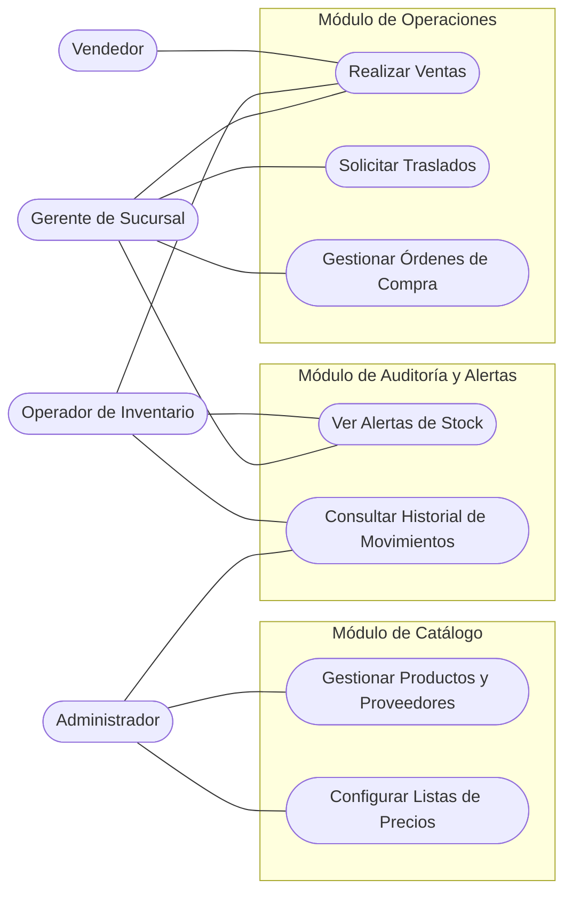

---

## 2. Diagramas de Actividades (Flujos)

### 2.1 Flujo de Venta
Proceso desde la selección de productos hasta la actualización del inventario.

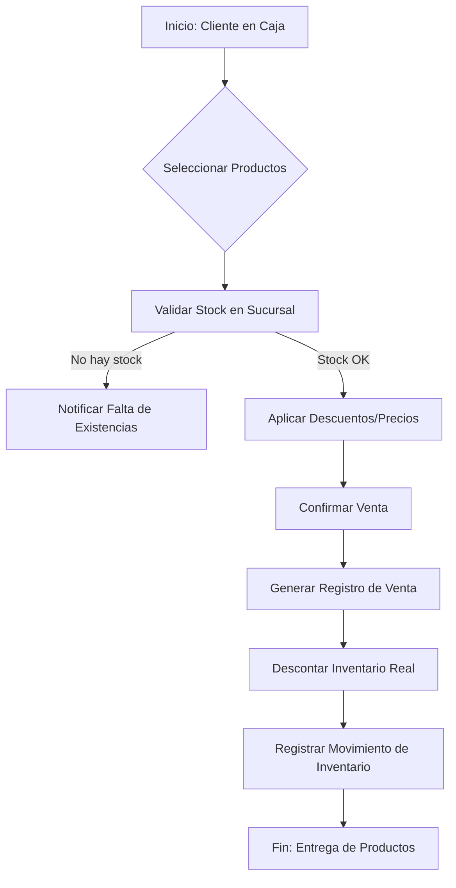

### 2.2 Flujo de Transferencia entre Sucursales
Proceso logístico interno para el balance de inventario.

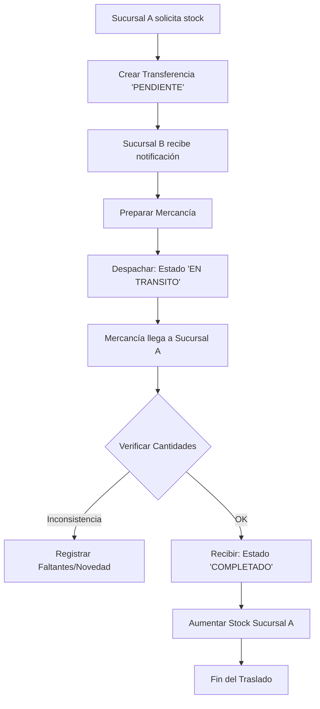

---

## 3. Diagrama de Arquitectura
Representación de la **Arquitectura Hexagonal (Puertos y Adaptadores)** utilizada en el backend.

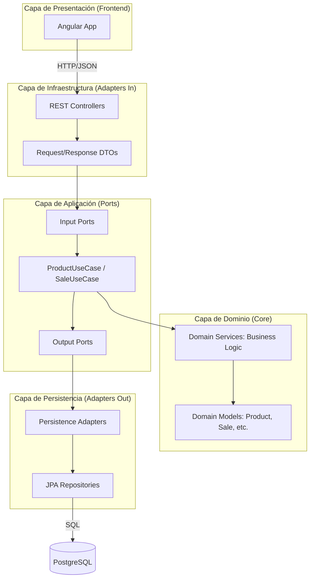

---

## 4. Diagrama Entidad-Relación (E-R)
Modelo de datos completo con relaciones, basado en la estructura de `base.sql`.

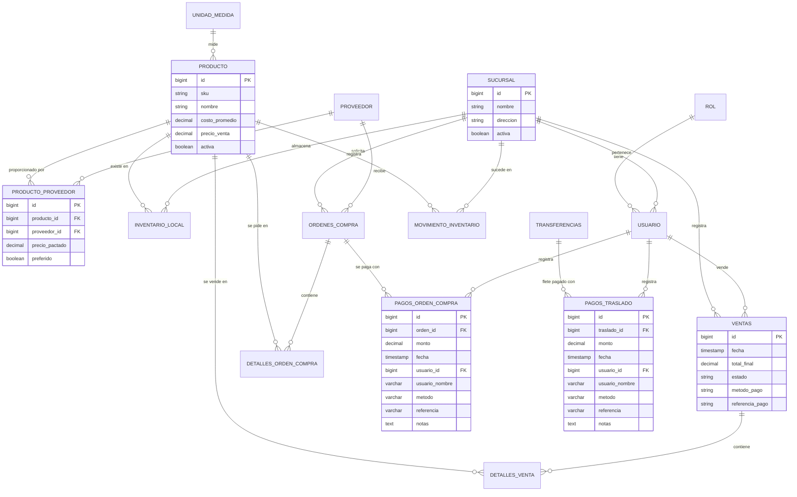

---

## 5. Diagramas de Clases (Modelo de Dominio)
Clases del dominio del backend (`domain/model` de cada módulo). Se omiten getters y campos de auditoría para mantenerlos legibles.

### 5.1 Ventas, devoluciones y catálogo
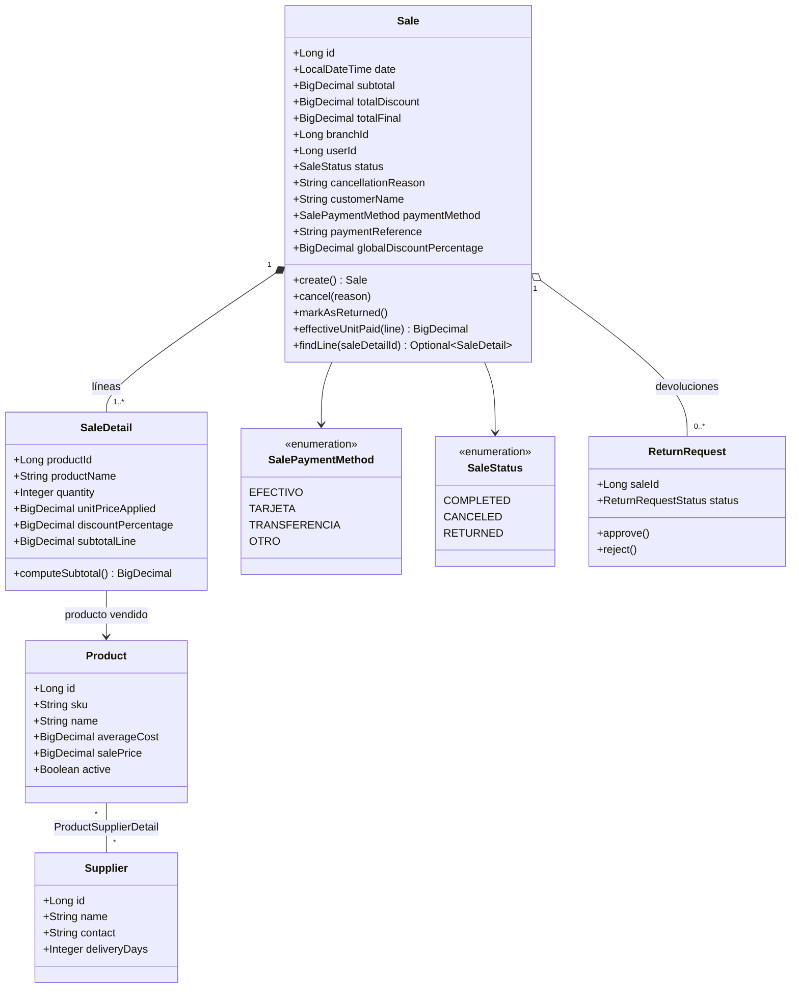

### 5.2 Inventario y alertas
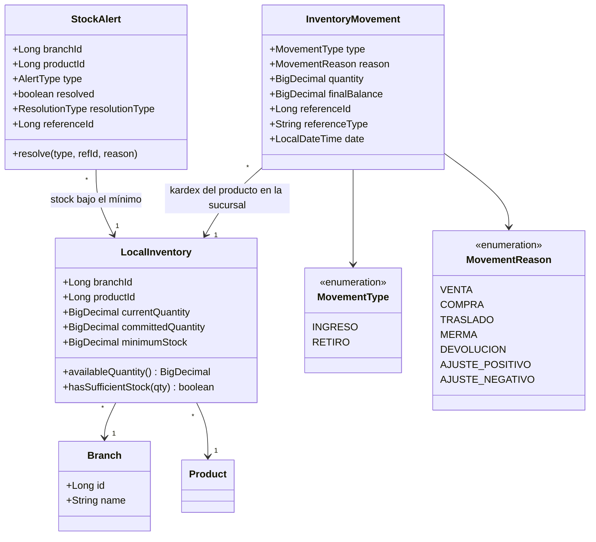

### 5.3 Traslados y compras
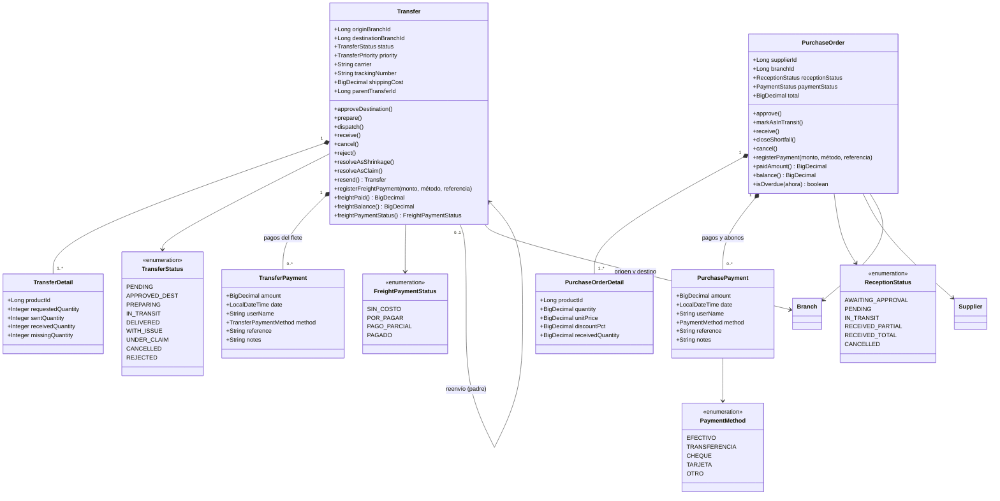

### 5.4 Usuarios y sucursales
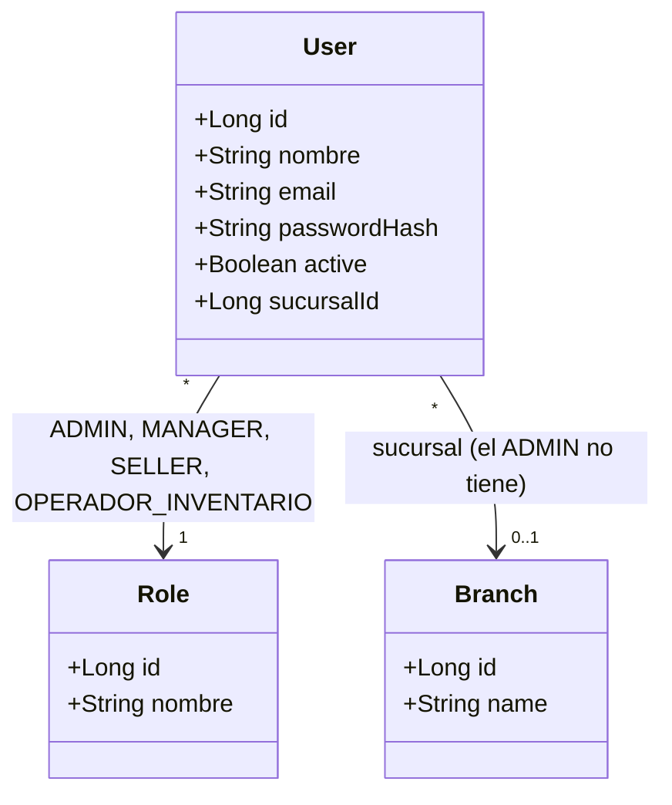

---

## 6. Diagramas de Secuencia

### 6.1 Inicio de sesión (`POST /api/auth/login`)
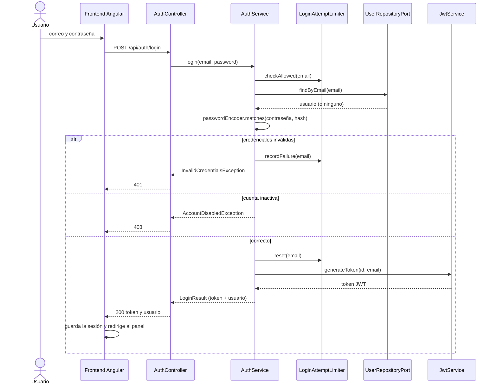

### 6.2 Registro de una venta (`POST /api/v1/sales`)
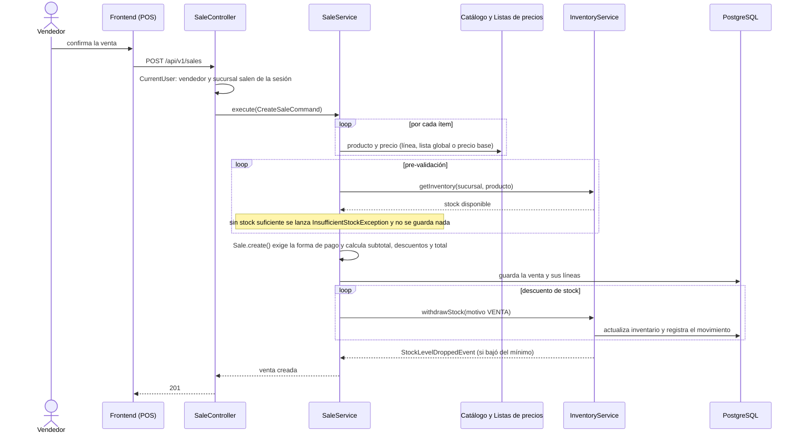

### 6.3 Alerta de stock bajo y resolución por traslado
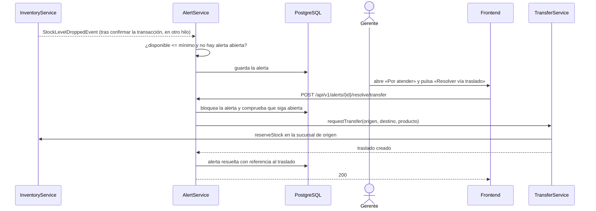

### 6.4 Traslado entre sucursales
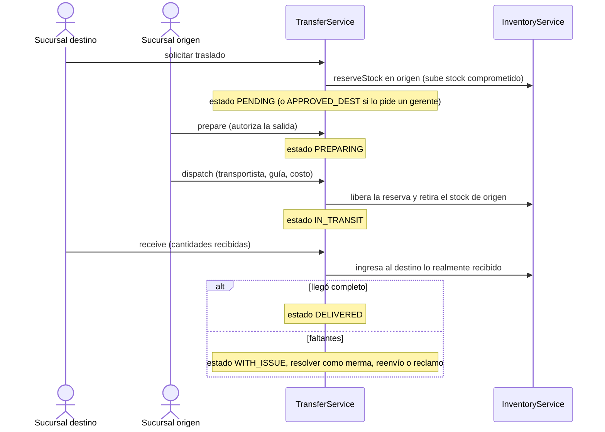

---

## 7. Analítica y reportes (Componente 4)

### 7.1 Indicadores por sucursal

El módulo `analytics` del backend es de **solo lectura**: no tiene tablas propias y calcula los números con SQL directo
(`JdbcTemplate`) sobre `ventas`, `detalles_venta`, `inventario_local`, `producto`, `sucursal` y `transferencias`.
Todos los endpoints viven en `/api/v1/analytics/…` y aceptan `branchId`; quien no es ADMIN queda limitado a su propia
sucursal (`CurrentUser`), así que el mismo panel sirve para la empresa entera o para una sede.

| Indicador | Endpoint | Cómo se calcula |
|---|---|---|
| Ventas del periodo | `global-summary`, `branch-performance` | Suma de `total_final` de las ventas `COMPLETED` en el rango de fechas, por sucursal. El total de una venta no se multiplica por sus líneas |
| Tendencia | `sales-trend`, `monthly-sales` | Serie diaria y comparativa de los últimos 6 meses (nombres de mes en español) |
| Más vendidos | `top-products` | Unidades vendidas por producto en el periodo |
| Valor del inventario | `valuations` | `cantidad_actual × costo_promedio` por sucursal |
| **Rotación** | `inventory-rotation` | `unidades vendidas ÷ existencia actual` por producto y sucursal. Solo cuenta ventas `COMPLETED` **de la misma sucursal** que la fila de stock. Un producto con existencias y sin ventas es *inventario sin movimiento*, con los días que lleva quieto |
| **Reabastecimiento** | `replenishment-insights` | Productos con `cantidad_actual ≤ 1,5 × stock_mínimo`. Prioridad ALTA si está en o bajo el mínimo y MEDIA hasta 1,5 veces el mínimo. Se ordena del más urgente (menor existencia/mínimo) al menos urgente |
| Traslados en curso | `transfers-impact` | Cantidad y valor (a costo promedio) de lo que está en tránsito |

En el frontend todo se ve en el **Panel** (`/dashboard`): tarjetas «Por atender» (reabastecimiento), «Más vendidos»,
«Por sede», «Meses recientes» y «Sin movimiento» (rotación). Los vendedores entran al panel sin indicadores.
**Reportes** (`/reports`) arma el cierre de caja y las ventas por vendedor, con lo cobrado por forma de pago, para
imprimir o guardar como PDF.

### 7.2 Kardex e historial de movimientos

Ningún módulo cambia el stock directamente: lo hace `InventoryService`, que bloquea la fila y deja un registro en
`movimiento_inventario` con el tipo (ingreso o retiro), el motivo (venta, compra, traslado, devolución, ajuste, merma…),
la cantidad, el **saldo resultante**, el usuario, la fecha y el documento de origen. Por eso el último saldo del kardex
coincide siempre con la existencia.

| Consulta | Endpoint | Roles |
|---|---|---|
| Kardex de un producto en una sucursal | `GET /api/v1/inventory/branches/{branchId}/products/{productId}/kardex` | Todos (sobre su sucursal) |
| Historial de movimientos | `GET /api/v1/inventory/movements` | ADMIN (todas las sucursales), MANAGER y OPERADOR (la suya) |

En **Inventario → Kardex** se filtra por uno o varios productos, por tipo, por motivo, por rango de fechas (el día
«Hasta» se incluye completo) y por texto.

### 7.3 Auditoría

**Auditoría global** (`/audit`, solo ADMIN) lista todos los movimientos de inventario del sistema con quién los hizo,
cuándo, en qué sucursal y desde qué documento, con filtros por sucursal, responsable, tipo, motivo y fechas, y el detalle
de cada movimiento. Además, cada paso de un traslado (solicitó, autorizó, despachó, recibió, resolvió) y de una compra
guarda su usuario y su fecha. La auditoría no registra acciones que no mueven stock, como los inicios de sesión.

### 7.4 Datos de demostración

`scripts/demo-data` simula, día a día y en orden cronológico, una distribuidora de materiales de construcción:
6 sucursales activas, 173 productos, 16 proveedores, 36 usuarios y 6 meses de historia (~18.000 ventas, ~2.400 compras,
~700 traslados, ~280 devoluciones, ~50.000 movimientos y las alertas de stock bajo). Como se simula en orden, los datos
respetan las reglas del sistema: el stock es la suma de sus movimientos, las compras mueven el costo promedio con la
misma fórmula del backend y una venta anulada devuelve el stock.

```bash
python3 scripts/demo-data/demo_data.py load    # local, sobre el contenedor zenvory-db (~10 s)
python3 scripts/demo-data/demo_data.py clean   # quita solo lo de la demostración
python3 scripts/demo-data/demo_data.py sql > demo.sql   # para cargarlo en Neon con psql (ver DEPLOY.md)
```

Se entra con `admin@demo.zeninventory.co` (o cualquier `nombre.apellido@demo.zeninventory.co`), contraseña `Demo-2026*`.
Los datos de demostración se reconocen por su dominio de correo y sus ids fijos, así que `clean` no toca lo demás.

---

## 8. Calidad y despliegue (Componente 5)

### 8.1 Pruebas

| Capa | Herramienta | Dónde | Qué cubre | Cantidad |
|---|---|---|---|---|
| Unitarias backend | JUnit 5, Mockito | `backend/src/test` | Servicios de dominio y reglas de negocio (stock, costo promedio, traslados, pagos, login) | 334 pruebas |
| Integración backend | Spring `@WebMvcTest`, `@JdbcTest` + Testcontainers | `backend/src/test` | Controladores con seguridad y roles; consultas SQL de analítica contra un PostgreSQL 16 real con las migraciones de Flyway | (incluidas arriba) |
| Unitarias y componentes frontend | Vitest, Testing Library | `*.spec.ts` junto a cada archivo | Componentes, páginas y servicios de Angular | 1.340 pruebas en 105 archivos (con las de MSW) |
| Integración HTTP frontend | MSW | `frontend-angular/src/testing/integration` | El cliente HTTP contra respuestas simuladas de la API | (incluidas arriba) |
| E2E | Playwright | `frontend-angular/e2e` | Navegación, login, roles, diseño adaptable, y flujos de negocio contra el backend real: venta, compra, analítica, kardex y auditoría | 43 pruebas en 11 archivos |

```bash
cd backend && ./mvnw test                     # requiere Java 21; con Docker corre también Testcontainers
cd frontend-angular && npm test               # no `ng test`: su pretest limpia la caché de Vitest
cd frontend-angular && E2E_USER=… E2E_PASSWORD=… npm run test:e2e   # con el backend en localhost:8080
```

Los flujos de `e2e/negocio` solo corren si se definen `E2E_USER` y `E2E_PASSWORD` (un ADMIN de pruebas). Sin esas
variables se saltan, para que `npm run test:e2e` funcione sin backend.

### 8.2 Integración continua

`.github/workflows/ci.yml` corre en cada pull request y en cada push a `master`, en dos trabajos en paralelo:

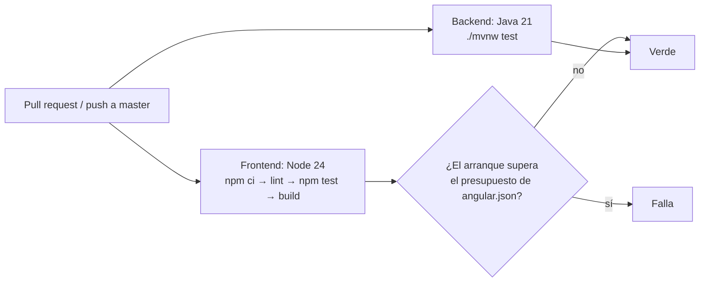

Una ejecución nueva de la misma rama cancela la anterior. El E2E no corre en CI porque necesita el backend real.

### 8.3 Contenedores

`docker-compose.yml` levanta todo el sistema en local:

| Servicio | Imagen | Puerto | Notas |
|---|---|---|---|
| `db` | `postgres:16-alpine` | 5432 | Volumen `pgdata`, con healthcheck |
| `pgadmin` | `dpage/pgadmin4` | 5050 | Administración de la base |
| `backend` | `backend/Dockerfile` (multietapa: Maven → JRE 21 Alpine) | 8080 | Arranca cuando la base está sana. Flyway migra al iniciar. `TZ=America/Bogota` |
| `frontend-angular` | `frontend-angular/Dockerfile` (build de Angular → nginx) | 4200 | nginx sirve la SPA y reenvía `/api/*` al backend |

La imagen del backend limita el heap al 70 % de la memoria del contenedor y usa el recolector serial, pensado para los
~512 MB de los planes gratuitos.

### 8.4 Despliegue en la nube

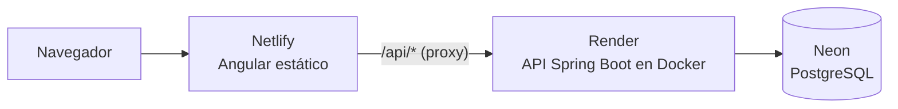

- **Neon:** PostgreSQL administrado. Se usa el host **directo**, no el `-pooler`, porque Flyway necesita sesión y
  bloqueos que PgBouncer en modo transacción no da.
- **Render:** Web Service con `backend/Dockerfile`, perfil `prod` (sin Swagger, cuentas de ejemplo desactivadas por
  `DefaultAccountsGuard`), secreto JWT propio y administrador inicial por variables de entorno.
- **Netlify:** construye `frontend-angular` y, con `netlify.toml`, reenvía `/api/*` a Render (el navegador solo habla
  con un dominio) y manda las demás rutas a `index.html` para que las resuelva Angular.

Pasos, variables y lista de comprobación en `DEPLOY.md`. Limitación del plan gratuito: Render duerme la API tras
~15 minutos sin tráfico, y el primer request después tarda entre 30 y 90 s. Para evitarlo se la llama periódicamente
(un monitor externo cada 5 minutos y, como respaldo, el workflow `keep-alive.yml` cada 10) en `GET /api/auth/login`,
que responde sin consultar la base: Render no se duerme y Neon puede apagarse cuando nadie usa la app.
