# Documentación Técnica Integrada: Zen Inventory (OptiPlant)

Este documento contiene los diagramas de ingeniería requeridos para la comprensión técnica del sistema de gestión de inventario multi-sucursal.

---

## 1. Diagrama de Casos de Uso
Describe los actores del sistema y sus interacciones principales con los módulos funcionales.

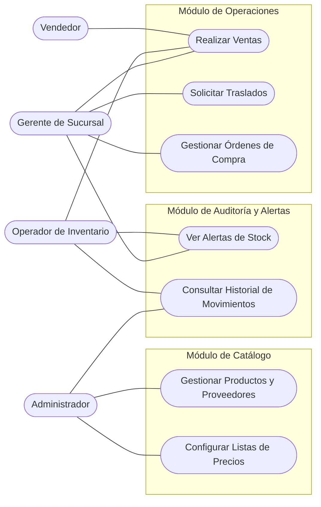

---

## 2. Diagramas de Actividades (Flujos)

### 2.1 Flujo de Venta
Proceso desde la selección de productos hasta la actualización del inventario.

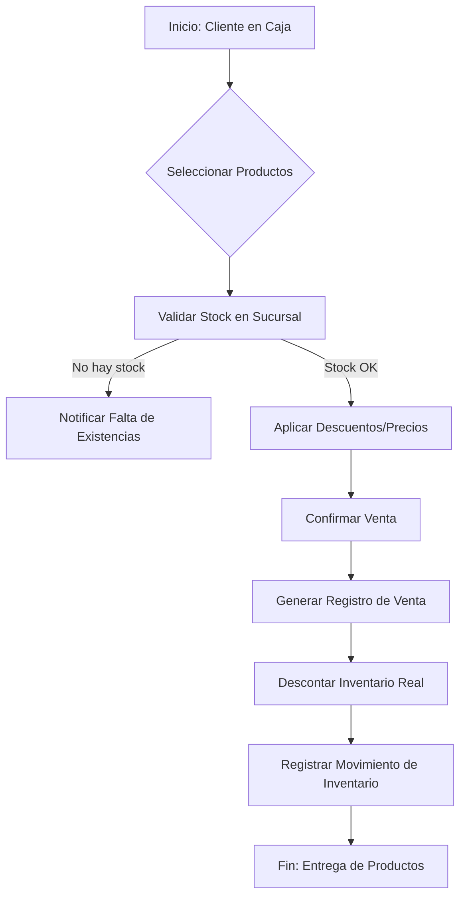

### 2.2 Flujo de Transferencia entre Sucursales
Proceso logístico interno para el balance de inventario.

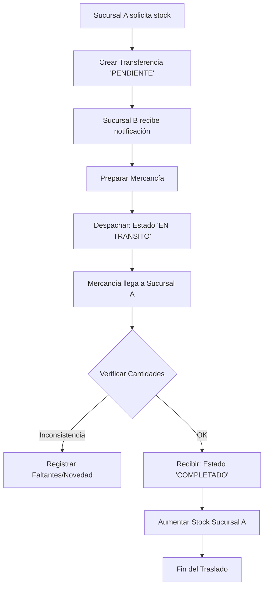

---

## 3. Diagrama de Arquitectura
Representación de la **Arquitectura Hexagonal (Puertos y Adaptadores)** utilizada en el backend.

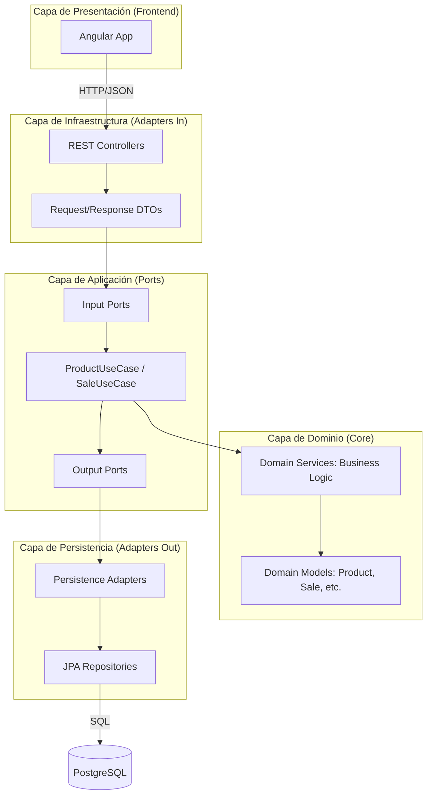

---

## 4. Diagrama Entidad-Relación (E-R)
Modelo de datos completo con relaciones, basado en la estructura de `base.sql`.

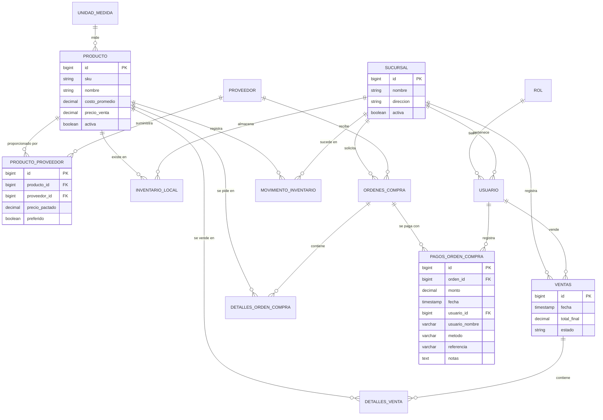

---

## 5. Diagramas de Clases (Modelo de Dominio)
Clases del dominio del backend (`domain/model` de cada módulo). Se omiten getters y campos de auditoría para mantenerlos legibles.

### 5.1 Ventas, devoluciones y catálogo
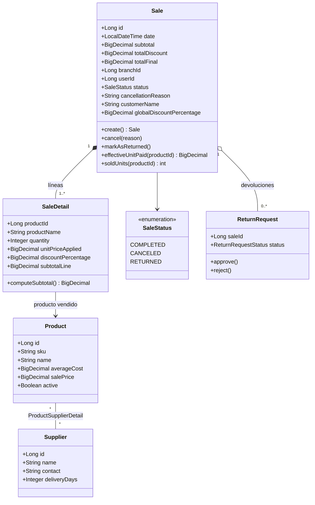

### 5.2 Inventario y alertas
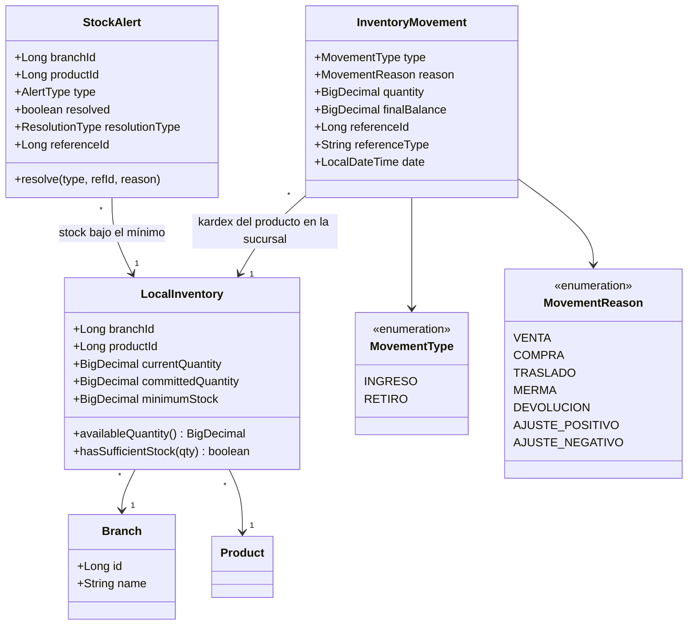

### 5.3 Traslados y compras
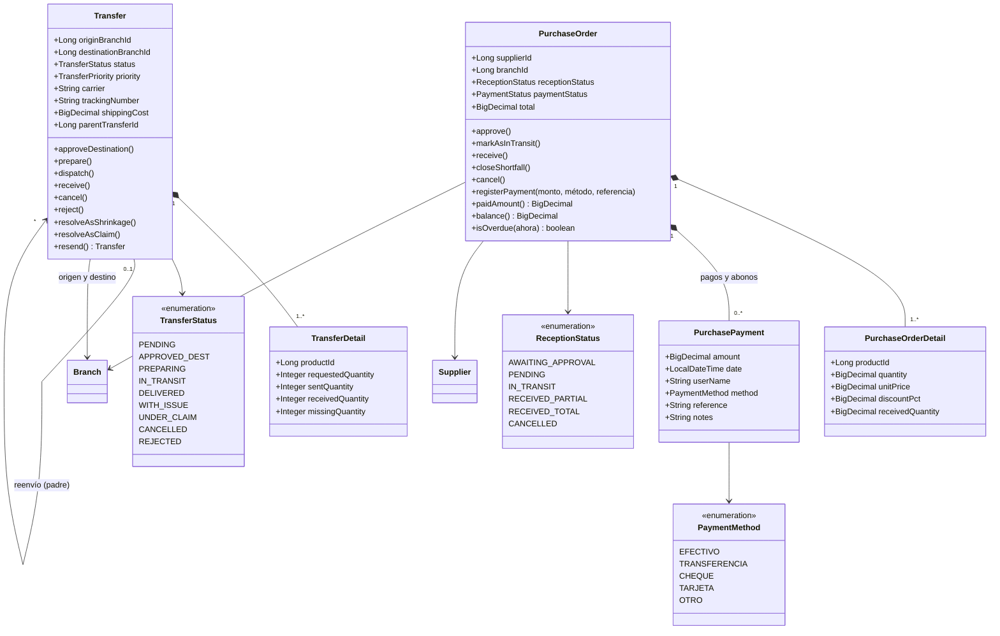

### 5.4 Usuarios y sucursales
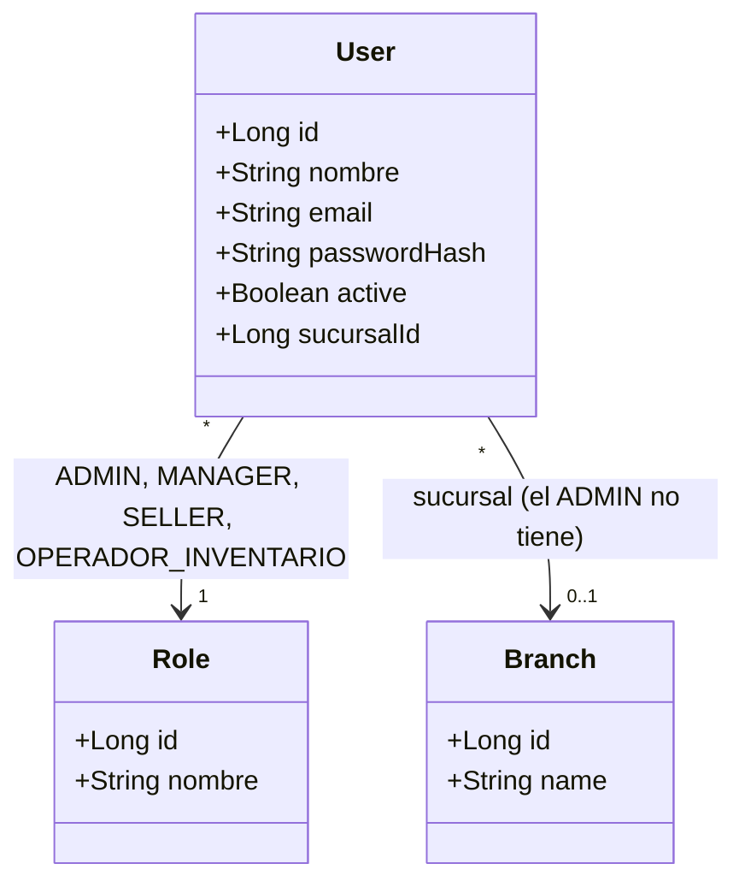

---

## 6. Diagramas de Secuencia

### 6.1 Inicio de sesión (`POST /api/auth/login`)
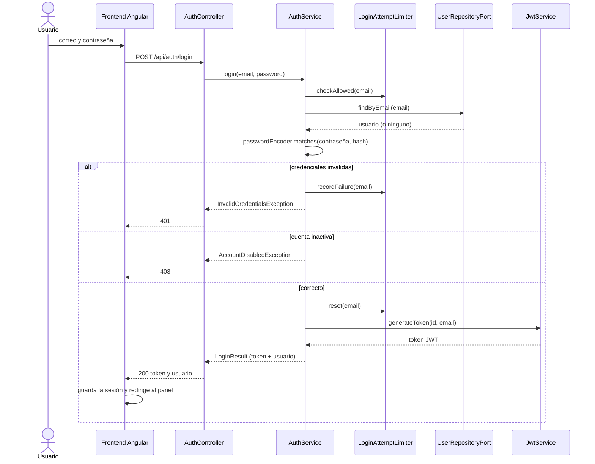

### 6.2 Registro de una venta (`POST /api/v1/sales`)
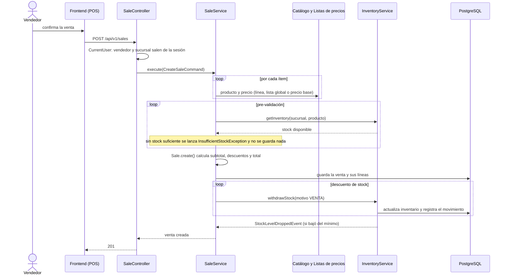

### 6.3 Alerta de stock bajo y resolución por traslado
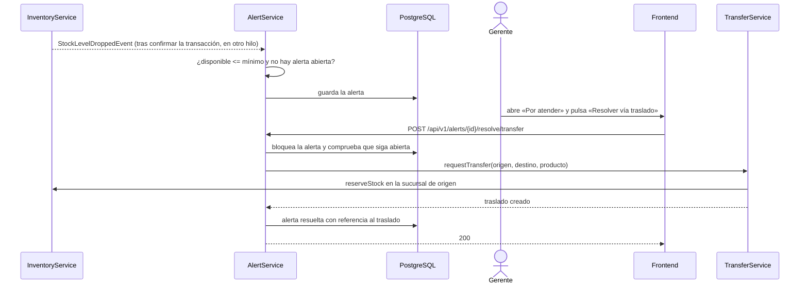

### 6.4 Traslado entre sucursales
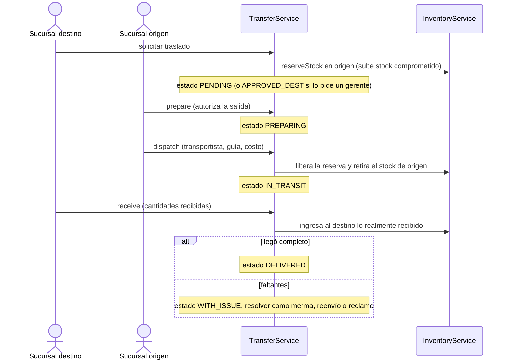
